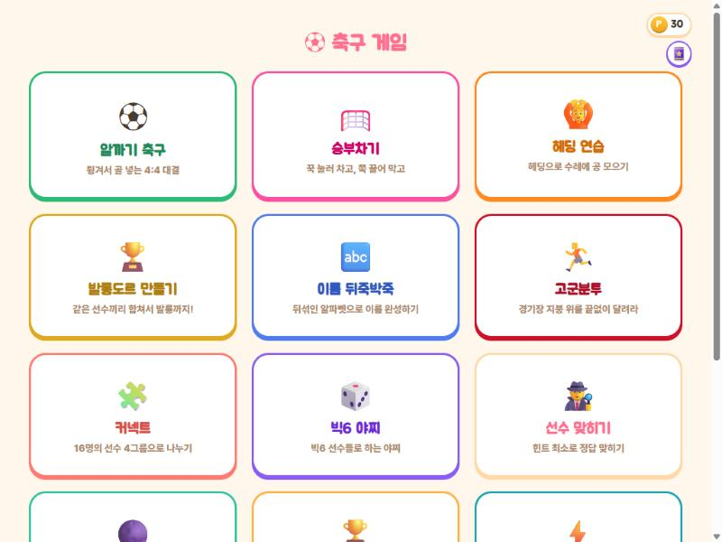
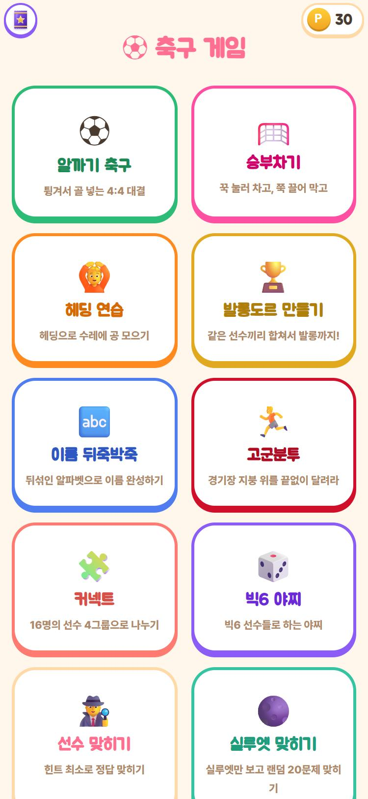
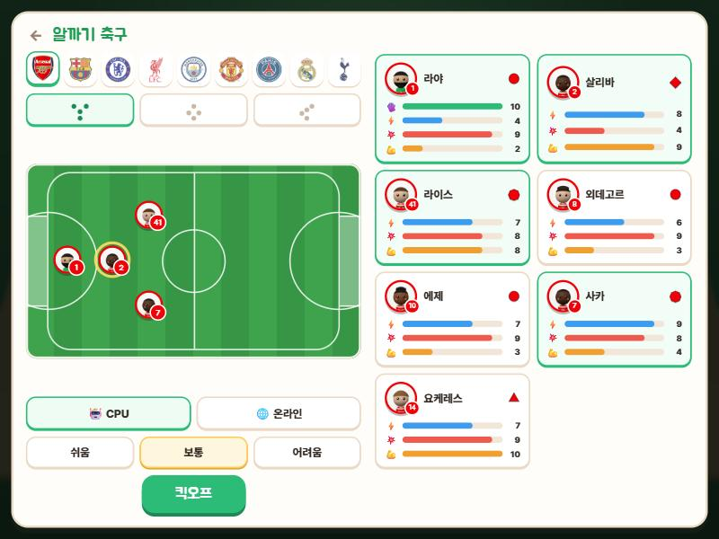
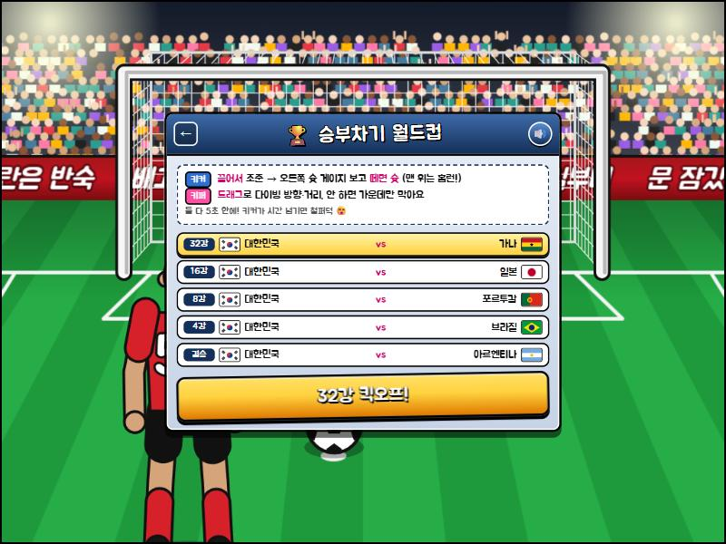
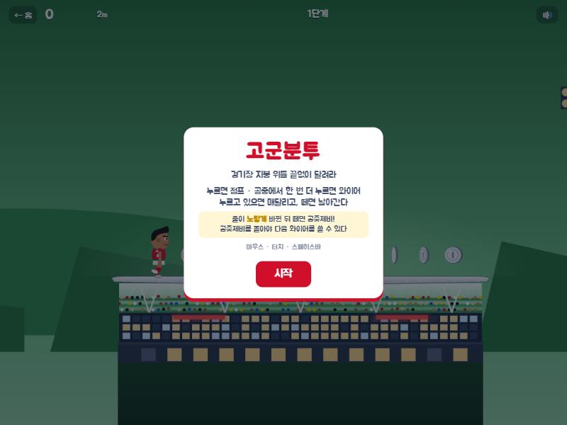
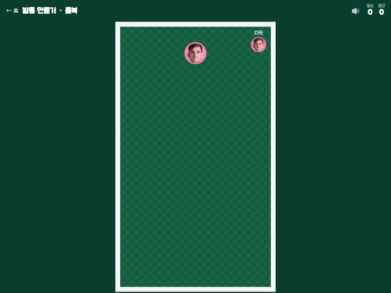
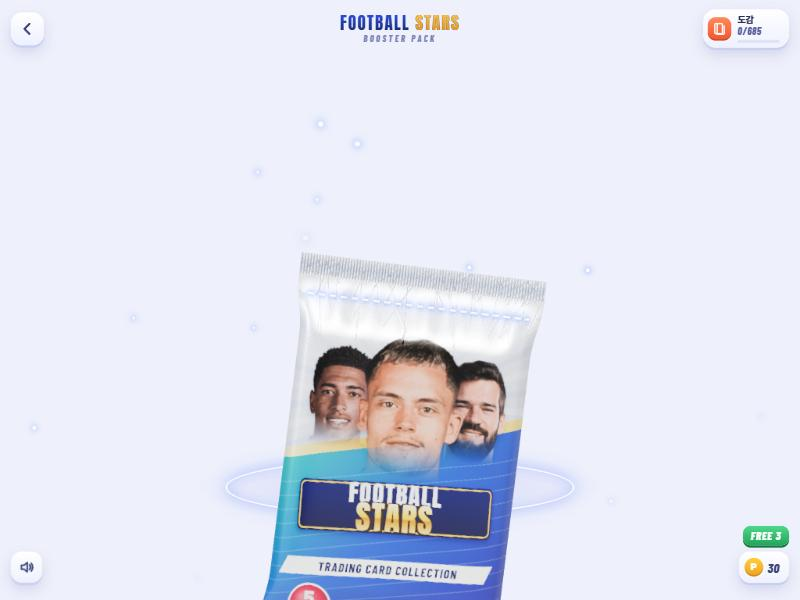
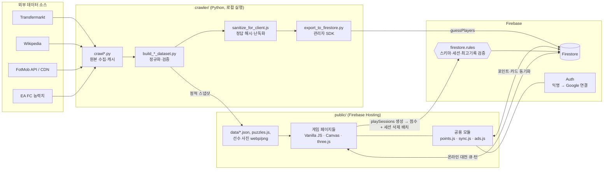

# ⚽ 축구 게임 (Guess Your Player)

> 축구 팬을 위한 **14종 미니게임 + 카드팩 수집** 웹사이트. 서버 없이 정적 페이지와 Firebase만으로 리더보드, 온라인 1:1 대전, 계정 동기화까지 만들었습니다.

- **라이브**: https://guess-your-player.web.app
- **이용자**: 이용자 약 2,600명 · 누적 플레이 기록 약 16만 건 (2026-11 기준, 익명 계정 포함 Firestore 사용자 문서·플레이 로그 수)
- **개발 기간**: 2026.09 ~ 2026.11 (약 2개월, 1인 개발)
- **개발 방식**: AI 코딩 도구(Claude Code 등)를 이용한 바이브 코딩. 기획, 데이터 설계, 검증은 직접 했습니다 ([아래](#-ai-활용--바이브코딩-방식) 참고)

<p align="center">
  
  
</p>

| 알까기 축구 (three.js, CPU·온라인 대전) | 승부차기 월드컵 | 고군분투 (러닝 액션) |
|---|---|---|
|  |  |  |
| **발롱도르 만들기 (머지 퍼즐)** | **카드팩 (3D 카드 개봉)** | |
|  |  | |

---

## 🎮 게임 목록

| 게임 | 설명 | 경로 |
|---|---|---|
| 알까기 축구 | 4:4 바블헤드 축구. 드래그로 방향·세기를 정하면 양 팀의 수가 동시에 물리로 진행. CPU(3단계)·랜덤 매칭·친구 방 | [`public/football/`](public/football/) |
| 승부차기 | 키커는 꾹 눌러 게이지, 키퍼는 드래그로 다이빙. CPU 월드컵 모드(32강~결승)와 온라인 대전 | [`public/penalty/`](public/penalty/) |
| 헤딩 연습 | 60초 동안 헤딩 릴레이로 수레에 공을 배달하는 타이밍 게임 | [`public/heading/`](public/heading/) |
| 발롱도르 만들기 | 같은 선수끼리 합쳐 발롱도르까지 키우는 머지 퍼즐(수박게임류). 물복/딱복 두 가지 물리 | [`public/jelly/`](public/jelly/) |
| 이름 뒤죽박죽 | 선수 풀네임 알파벳을 섞어 놓고 타일을 눌러 복원 | [`public/scramble/`](public/scramble/) |
| 고군분투 | 원버튼 러닝 액션(점프 + 와이어). 고정 4단계 뒤 무한 코스 | [`public/gogun/`](public/gogun/) |
| 커넥트 | 선수 16명을 공통점 4그룹으로 나누는 퍼즐 (100문제) | [`public/connect/`](public/connect/) |
| 빅6 야찌 | 빅6 클럽 선수 카드로 하는 야찌, 13라운드 총점 | [`public/index.html`](public/index.html) |
| 선수 맞히기 (클래식/챌린지) | 커리어·우승·국적 등 힌트를 적게 열수록 고득점 | [`public/index.html`](public/index.html) |
| 실루엣 맞히기 | 실루엣만 보고 랜덤 20문제 | [`public/index.html`](public/index.html) |
| 기록 맞히기 (개인/팀) | 기록을 보고 주인공(선수·팀) 맞히기 | [`public/index.html`](public/index.html) |
| 선수 CAPTCHA | "아스날 + 수비수"처럼 조건에 맞는 선수 사진을 빠르게 고르는 스피드런 | [`public/index.html`](public/index.html) |
| 등번호 블랙잭 | 등번호 합 90을 목표로 하는 블랙잭, 사이트 포인트로 베팅 | [`public/blackjack/`](public/blackjack/) |
| 카드깡 | 하루 무료 팩 + 포인트로 카드팩 개봉, 685장 도감 수집 | [`public/card/`](public/card/) |
| 관리자 페이지 | 종목별 판수 통계·그래프, 리더보드 관리, 포인트 지급 (구글 관리자 로그인) | [`public/bymile/`](public/bymile/) |

> 선수 맞히기 계열(맞히기, 실루엣, 기록, CAPTCHA, 빅6)은 초기에 만든 게임이라 메인 [`index.html`](public/index.html) 한 파일 안에 들어 있고, 이후 게임은 폴더 단위로 나눴습니다.

---

## 🛠 기술 스택

| 영역 | 사용 기술 |
|---|---|
| 프론트엔드 | Vanilla JavaScript (ES Modules), HTML, CSS. 빌드 도구와 프레임워크 없음 |
| 그래픽 | Canvas 2D (헤딩·승부차기·고군분투·발롱도르), [three.js](https://threejs.org/) 0.160 (알까기 축구, 카드팩 3D), SVG (관리자 차트를 라이브러리 없이 직접 그림) |
| 오디오 | Web Audio API로 효과음 합성 (`*/audio.js`) |
| 백엔드 (BaaS) | Firebase Hosting, Cloud Firestore, Firebase Auth (익명 + Google 연결) |
| 보안 | Firestore Security Rules (460줄, 리더보드 위조 방지·스키마 검증) |
| 데이터 파이프라인 | Python (requests, BeautifulSoup, Pillow, firebase-admin), Node.js (정답 난독화 스크립트) |
| 개발 도구 | AI 코딩 도구(Claude Code + oh-my-claudecode), Firebase CLI·에뮬레이터, 캐시를 끈 로컬 서버([`tools/dev_server.py`](tools/dev_server.py)) |

---

## 🏗 아키텍처



- **브라우저는 외부 축구 데이터 API를 직접 부르지 않습니다.** 크롤러가 미리 만든 스냅샷(JSON·이미지)만 정적 파일로 받습니다.
- 선수 맞히기의 정답 데이터는 Firestore(`guessPlayers`)에 두되, 정답 문자열은 해시/난독화된 형태로만 올립니다.
- 리더보드, 플레이 통계, 온라인 대전, 계정 데이터는 모두 브라우저가 Firestore에 직접 쓰고, **규칙(rules)이 서버 역할**을 합니다.

---

## 🧩 기술적 도전과 해결

### 1. 로그인 없는 리더보드에서 "콘솔로 만점 쓰기" 막기
**문제**: 서버가 없고 Firebase 웹 설정은 원래 공개값이라, 누구나 개발자 도구에서 `setDoc()`으로 1위 기록을 써 넣을 수 있었습니다.

**해결**: 서버 시간과 원자적 커밋만 쓰는 "플레이 세션 증명"을 규칙으로 만들었습니다.
- 게임 시작 시 `playSessions/{game}_{deviceId}` 문서를 **서버 타임스탬프**로 생성 ([`logPlay()`](public/index.html#L1223))
- 점수는 반드시 세션 문서 삭제와 **같은 batch**로 커밋 ([`commitLeaderboardScore()`](public/index.html#L1245))
- 규칙의 [`sessionConsumed()`](firestore.rules#L24)가 ① 세션이 존재하고 ② 게임별 최소 시간(2~45초)이 지났고 ③ 이 커밋으로 지워지는지 `exists / get / existsAfter`로 검증
- 점수는 `int`로 강제(`0.0001` 같은 값으로 영구 1위 방지), 게임 상수로 계산한 이론상 최대치를 상한으로, **기존 기록보다 좋을 때만** 덮어쓰기
- 승부차기 월드컵은 `score == stage*1e6 + gf*1e3 + (999-ga)`처럼 정렬용 점수가 원본 값에서 계산된 것인지까지 검증 ([`firestore.rules`](firestore.rules#L400))

한계(자동화된 실제 플레이는 못 막음)도 규칙 주석에 그대로 적어 두었습니다.

### 2. 서버 없이 실시간 1:1 온라인 대전
**문제**: 알까기 축구·승부차기 온라인 모드를 게임 서버 없이 Firestore만으로 만들어야 했습니다.

**해결**:
- **매칭**: 대기열 문서 + `runTransaction`으로 가장 오래 기다린 상대와 짝짓기, 4자리 코드 친구 방 ([`football/online.js`](public/football/online.js))
- **동기화**: 양쪽이 턴 입력만 올리고 각자 같은 입력으로 재생. 브라우저마다 부동소수점 결과가 미세하게 달라지는 문제는 **방장이 계산한 결과 상태로 양쪽을 맞춰** 해결
- 승부차기는 아예 **정수 입력 + 사칙연산·sqrt만 쓰는 순수 함수**로 판정해 삼각함수 차이 없이 양쪽이 같은 결과를 내도록 설계 ([`penalty/logic.js`](public/penalty/logic.js))

### 3. 결정론적 물리 엔진과 "깰 수 있는 코스" 자동 검증
- **알까기 축구**: 2D 충돌 물리를 렌더링(three.js)과 완전히 분리해서 ([`physics.js`](public/football/physics.js)), CPU AI가 월드를 복제해 후보 수를 끝까지 시뮬레이션하는 언덕 오르기 플래너를 만들 수 있었습니다. 계산은 프레임마다 조금씩 나눠 화면이 끊기지 않게 했습니다 ([`ai.js`](public/football/ai.js)).
- **고군분투**: 120Hz 고정 스텝 물리([`sim.js`](public/gogun/sim.js))를 게임과 코스 생성기가 같이 씁니다. 생성기([`tools/gogun/build_course.js`](tools/gogun/build_course.js))는 구간을 붙일 때마다 실제 물리로 풀어서 **입력 타이밍 여유(프레임)** 를 확인하고, 함정 동전은 무작위 입력 수천 개로 "먹고 살아남을 방법이 없는지" 검증한 뒤 고정 시드 코스를 출력합니다.

### 4. 정답 데이터가 바로 보이지 않게 하기
퀴즈 데이터는 결국 브라우저로 내려가기 때문에 네트워크 탭에서 정답이 보이면 안 됩니다. [`sanitize_for_client.js`](crawler/sanitize_for_client.js)가
- 정답 **매칭용** 값(이름·별칭)은 정규화(NFD 악센트 제거, 소문자, 공백·기호 제거) 후 **SHA-256 해시**로 바꾸고 평문 삭제
- 라운드가 끝난 뒤 **보여줘야 하는** 값(이름, 사진 URL, 출처)은 XOR+Base64로 뒤섞은 `*Enc` 필드로 교체

하고, 브라우저는 입력값을 같은 방식으로 해시해서 비교합니다 ([`normalize()`](public/index.html#L961), [`deobfuscate()`](public/index.html#L995)). 두 구현이 어긋나면 매칭이 깨지므로 양쪽에 "반드시 동일" 주석으로 묶어 두었습니다.

- **한계**: 해시에 소금(salt)이 없고 XOR 키도 클라이언트 코드에 있어서, 마음먹고 콘솔에서 풀면 정답을 볼 수 있습니다. 목표는 네트워크 탭을 열자마자 정답이 보이지 않게 하는 정도이고, 완전히 막으려면 채점을 서버로 옮겨야 합니다.

### 5. 로컬 우선(local-first) 포인트·카드 동기화
각 게임은 `localStorage`만 바꾸고 `rev`를 올립니다([`points.js`](public/points.js)). [`sync.js`](public/sync.js)가 익명 로그인 계정과 맞추는데,
- **rev가 큰 쪽이 이기는** 단순한 충돌 해결 ([`reconcile()`](public/sync.js#L163))
- 익명으로 쌓은 기록을 이미 쓰던 Google 계정에 연결할 때는 포인트는 잔액이 큰 쪽, 카드는 **양쪽 합집합(같은 카드는 많은 장수)** 으로 병합 ([`mergeData()`](public/sync.js#L142))
- 업로드는 800ms 디바운스, `pagehide`에서 남은 변경을 마저 올림

### 그 밖의 프론트엔드 디테일
- **이미지 로딩**: CAPTCHA·빅6는 시작 전에 사진을 `load` + `decode()`까지 끝내 두고 타이머를 시작합니다. 스핀 애니메이션 중 빈 프레임이 스치는 문제를 막기 위해서입니다 ([`big6PreloadImage()`](public/index.html#L2747)). 도감은 `loading="lazy"`, 카드 이미지는 webp를 씁니다.
- **웹폰트**: Google Fonts는 한글을 조각으로 나눠 받는데 Canvas에 그리는 글자는 다운로드를 일으키지 않습니다. 그래서 광고판 문구 글자를 `document.fonts.load()`로 미리 받습니다 ([`ads.js`](public/ads.js)).
- **반응형/모바일**: `clamp()`와 `env(safe-area-inset-*)`로 노치 대응, Pointer 이벤트로 마우스와 터치를 함께 처리, Canvas는 논리 해상도(800×600 등)로 그리고 화면에 맞춰 스케일합니다.
- **관리자 통계 성능**: 판마다 쌓이는 `playLogs`를 훑지 않고, 판 시작 때 `increment()`로 누적·일별 카운터 문서를 함께 올려 관리자 페이지는 문서 몇 개만 읽습니다.

---

## 🤖 AI 활용 / 바이브코딩 방식

이 프로젝트의 코드는 대부분 AI 코딩 도구와 대화하며 작성했습니다. 제 역할은 **무엇을 왜 만들지 정하고, 데이터를 설계하고, 결과가 맞는지 검증하는 것**이었습니다.

**1. 기획 문서를 먼저 쓰고 AI에 맡겼습니다** ([`design/`](design/))
- [`bobble_soccer_plan.md`](design/bobble_soccer_plan.md), [`gogun_soccer_plan.md`](design/gogun_soccer_plan.md): 레퍼런스 게임(Discord Bobble League, 한게임 고군분투)을 조사하고 **출처 신뢰도까지 표로 정리**한 뒤 규칙, 수치, 화면을 정했습니다. "원작 그림·소리·코드는 쓰지 않는다" 같은 제약도 문서에 적었습니다.
- [`scramble_plan.md`](design/scramble_plan.md): 출제 풀 438명에서 **유명도 기준으로 직접 걸러** 219명으로 줄인 과정과 기준을 기록했습니다.

**2. 데이터 설계는 직접 했습니다**
- [`data_schema.md`](design/data_schema.md), [`oxgame_data_schema.md`](design/oxgame_data_schema.md): Firestore 문서 구조와 힌트 템플릿, FotMob 엔드포인트별 필드와 검증 사례("에밀리아노 마르티네스로 월드컵 우승 판별 검증")를 정리했습니다.
- [`player_pool.md`](design/player_pool.md): 90명 선수 풀을 "현역 여부 웹 검색 교차 확인" 기준으로 확정했습니다.

**3. AI 이미지 생성 파이프라인** ([`design/silhouette-pilot/`](design/silhouette-pilot/))
- 실루엣 이미지 규격(1024 정사각, 순흑 실루엣/순백 배경, 머리 위 8% 여백, 얼굴 윤곽·헤어 보존)을 이미지 모델용 프롬프트로 먼저 정의했습니다([`PROMPT.txt`](design/silhouette-pilot/PROMPT.txt)).
- 같은 규격을 **코드로 재현하는 결정론적 파이프라인**을 만들었습니다. rembg 배경 제거([`generate_silhouettes.py`](design/silhouette-pilot/tools/generate_silhouettes.py))로 시작해서, 이미 누끼가 따진 FotMob 렌더를 쓰는 방식([`build_from_fotmob.py`](design/silhouette-pilot/tools/build_from_fotmob.py))으로 바꿨습니다. 결과는 staging 폴더(v1→v3)와 리뷰 시트(contact sheet)로 눈으로 확인한 다음에만 `public/`에 반영했습니다. (원본 사진 다운로드와 staging 이미지는 재생성 가능하고 용량이 커서 저장소에서 제외했고, 리뷰 시트와 메타데이터만 남겼습니다.)

**4. 검증은 AI 말을 믿지 않고 직접 했습니다**
- 규칙 상한값은 게임 상수로 직접 계산해 주석에 남겼습니다(예: 빅6 최대 390점 = 팀 150 + 보너스 30 + ...).
- 커넥트 퍼즐 100개는 [`test_connect_logic.js`](crawler/test_connect_logic.js)로 **16명을 4그룹으로 나누는 완성 경로가 존재하고 10개를 넘지 않는지**, 사진 파일이 실제로 있는지 검사합니다.
- 고군분투 코스는 생성기가 직접 풀어 보고 깰 수 없는 구간은 버립니다.
- 모바일·데스크톱 실제 플레이 확인, Firestore 에뮬레이터로 규칙 확인을 릴리스 체크리스트로 썼습니다.

**5. 코드에 "왜"를 남기게 했습니다**
코드 주석이 대부분 한국어로 **결정 이유**를 설명합니다(예: [`firestore.rules`](firestore.rules)의 세션 검증 한계, [`crawl.py`](crawler/crawl.py)의 "Transfermarkt 상세 스탯은 SPA라 위키 인포박스를 1차 소스로" 결정). AI가 만든 코드를 나중에 제가 다시 읽고 고칠 수 있게 하려는 목적이었습니다.

---

## 📁 프로젝트 구조

```
football-games/
├── public/                 # Firebase Hosting 루트 (빌드 없이 그대로 배포)
│   ├── index.html          # 홈 + 선수 맞히기·실루엣·기록·CAPTCHA·빅6
│   ├── points.js           # 사이트 공용 포인트 (localStorage)
│   ├── sync.js             # 익명/구글 계정 ↔ Firestore 동기화
│   ├── ads.js              # 경기장 광고판 문구 + 웹폰트 프리로드
│   ├── football/           # 알까기 축구 (physics / ai / render / online ...)
│   ├── penalty/            # 승부차기 (logic / render / online / rank)
│   ├── heading/ jelly/ gogun/ scramble/ connect/ blackjack/
│   ├── card/               # 카드팩 + 도감 (dev-*.html은 배포 제외 개발용 페이지)
│   ├── bymile/             # 관리자 통계 페이지 (/fhrm 별칭)
│   ├── data/               # 퀴즈용 정적 데이터 스냅샷
│   └── captcha/ big6/ reveal/ silhouettes/  # 선수 이미지 (저작권 때문에 저장소에서 제외)
├── crawler/                # Python 데이터 파이프라인
├── tools/                  # 로컬 개발 서버, 고군분투 코스 생성기
├── design/                 # 기획서, 데이터 설계 문서, 실루엣 파일럿 작업물
├── docs/images/            # README 스크린샷
├── firestore.rules         # 보안 규칙
└── firebase.json           # Hosting 설정 (no-cache 헤더, /fhrm 리라이트)
```

---

## 🚀 로컬 실행

빌드 과정이 없습니다. 정적 서버로 `public/`을 열면 됩니다.

> **선수 사진·구단 엠블럼은 저장소에 없습니다.** 실제 선수 사진과 엠블럼은 저작권이 있어서 `.gitignore`로 제외했습니다(목록은 `.gitignore` 참고). 로컬에서 실행하면 실루엣·CAPTCHA·빅6·커넥트·카드깡처럼 사진이 핵심인 게임은 이미지가 깨지고, 헤딩·승부차기·고군분투·발롱도르·선수 맞히기는 그대로 동작합니다. 완성된 화면은 [라이브 사이트](https://guess-your-player.web.app)에서 볼 수 있습니다.

```bash
python tools/dev_server.py 8830     # 캐시를 끈 정적 서버 → http://localhost:8830/
# 또는
python -m http.server 8830 --directory public
```

> 로컬에서도 Firebase는 **실제 프로젝트(guess-your-player)** 에 연결됩니다. 페이지를 열면 익명 로그인되고 게임을 시작하면 통계가 기록되니, 개발할 때는 Firebase 에뮬레이터나 별도 프로젝트를 쓰는 편이 안전합니다.

규칙 확인:

```bash
firebase emulators:start --only firestore --project demo-local
```

### 데이터 재생성 (crawler)

크롤링 원본과 캐시(`crawler/data/`, `crawler/cache/`, 약 465MB)와 서비스 계정 키(`crawler/secrets/`)는 **저장소에 포함하지 않습니다**(`.gitignore`). 게임에 필요한 데이터(`public/data/*.json`, `public/connect/puzzles.js`)는 이미 `public/`에 들어 있어서 사이트 실행에는 크롤러가 필요 없습니다.

```bash
python -m venv .venv && .venv/Scripts/activate      # macOS/Linux: source .venv/bin/activate
pip install requests beautifulsoup4 pillow firebase-admin

# 선수 맞히기 (guessPlayers)
python crawler/crawl.py                 # Transfermarkt + Wikipedia → crawler/data/raw/
python crawler/crawl_squads.py          # 유명 동료
python crawler/crawl_league_rank.py     # 지난 시즌 순위
python crawler/crawl_recent_ranks.py    # 최근 3시즌 순위
python crawler/crawl_wiki_honours.py    # 위키 Honours 절
python crawler/build_dataset.py         # → crawler/data/dataset.json
python crawler/export_to_firestore.py --dry-run   # 해시/난독화 결과만 확인 (--dry-run 없이 실행하면 업로드, 서비스 계정 키 필요)

# 정적 스냅샷 게임들 (FotMob)
python crawler/build_captcha_dataset.py     # public/data/captcha_players.json + 사진
python crawler/build_big6_dataset.py --photos
python crawler/build_connect_dataset.py     # 100문제 생성·검증 → public/connect/
python crawler/build_card_extra_players.py  # public/card/extra_players.json

node crawler/test_connect_logic.js          # 커넥트 퍼즐 검증 (crawler/data 리포트가 없으면 설계 그룹·힌트 검사는 건너뜀)
node tools/gogun/build_course.js            # 고군분투 코스 재생성 (시드 33)
```

`export_to_firestore.py`는 `crawler/secrets/firestore-uploader.json` 서비스 계정 키를 씁니다. Firebase 콘솔에서 직접 발급해 넣어야 하며 절대 커밋하지 않습니다.

---

## 🔒 보안 메모

- `public/*.js`의 Firebase 웹 설정(apiKey 등)은 [원래 공개되는 값](https://firebase.google.com/docs/projects/api-keys)입니다. 접근 제어는 `firestore.rules`가 합니다.
- 규칙 점검에서 아래 문제를 발견했고, **수정한 `firestore.rules`를 Firestore 에뮬레이터로 확인한 뒤 라이브에 배포**했습니다. 지금 저장소와 서비스에는 아래 문제가 남아 있지 않습니다.
  - 전체 공개 읽기 규칙(`match /{document=**} { allow read: if true }`)이 OR로 합쳐져 `users`·`accountEmails`·`grants`의 "본인/관리자만 읽기" 제한을 무력화하던 문제 → 제거
  - 리더보드 `delete`가 누구에게나 열려 있던 문제 → `isAdmin()`으로 제한
  - IP가 담긴 `playLogs`·`fhrmAccessLog` 공개 읽기 → `isAdmin()`으로 제한

---

## 🔁 회고 / 개선 계획

**잘한 점**
- 서버 없이 규칙만으로 위조 방지, 온라인 대전, 계정 병합까지 해결했습니다. 각 방법의 한계도 주석과 문서로 남겼습니다.
- 물리와 렌더링, 규칙과 화면을 분리해서 AI·시뮬레이션·자동 검증을 같은 코드로 돌릴 수 있었습니다.

**아쉬운 점과 개선 계획**
- **중복 코드**: Firebase 초기화와 리더보드 읽기/쓰기 코드가 12곳에 복사돼 있습니다. 공용 `firebase.js` / `leaderboard.js` 모듈로 묶을 계획입니다.
- **거대한 단일 파일**: `public/index.html`(약 18만 자)에 게임 5종이 들어 있습니다. 게임별 모듈로 쪼개고, Vite 같은 번들러를 도입해 코드 분할과 이미지 최적화를 자동화하려 합니다.
- **포인트 신뢰성**: 포인트와 카드는 `localStorage`가 원본이라 사용자가 고칠 수 있습니다. 중요해지면 Cloud Functions로 서버 검증을 옮겨야 합니다.
- **이미지 용량**: `public/`이 약 42MB입니다(사진 약 1,700장). png를 webp/avif로 바꾸고 해상도별 `srcset`을 쓰면 크게 줄일 수 있습니다. 512px 아이콘(`football-icon.png`, 1.4MB)도 압축할 수 있습니다.
- **테스트 자동화**: 지금은 커넥트 로직 테스트와 수동 QA뿐입니다. 규칙 단위 테스트(`@firebase/rules-unit-testing`)와 순수 로직(`penalty/logic.js`, `heading/logic.js`, `scramble/logic.js`) 테스트를 CI에 붙이려 합니다.
- **개발 환경 분리**: 로컬 개발도 실서비스 Firestore에 붙습니다. 에뮬레이터 자동 연결 스위치를 둘 계획입니다.

---

## 📝 데이터 출처 및 고지

선수 정보와 이미지는 Transfermarkt, Wikipedia, FotMob, EA SPORTS FC 공개 데이터를 바탕으로 비상업적 팬 프로젝트로 만들었습니다. 모든 선수 이름, 사진, 구단 엠블럼의 권리는 각 권리자에게 있습니다.
